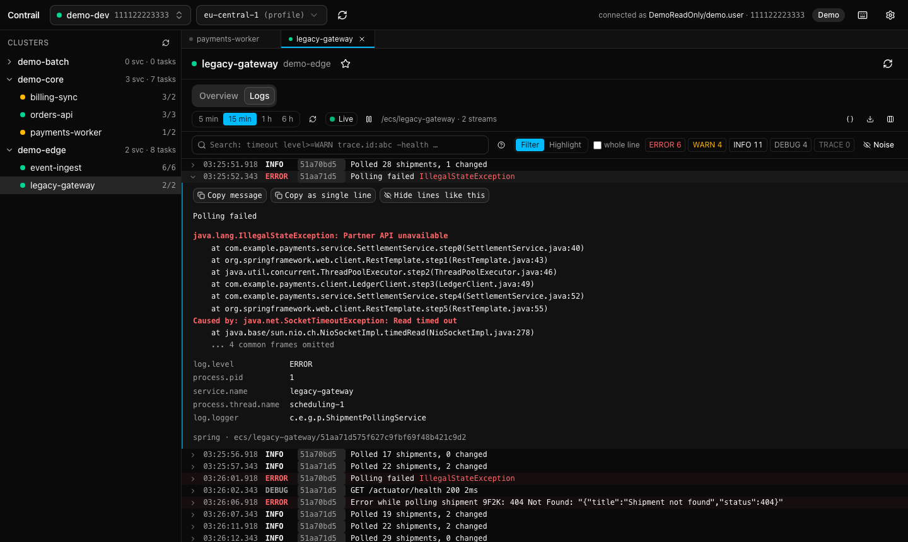
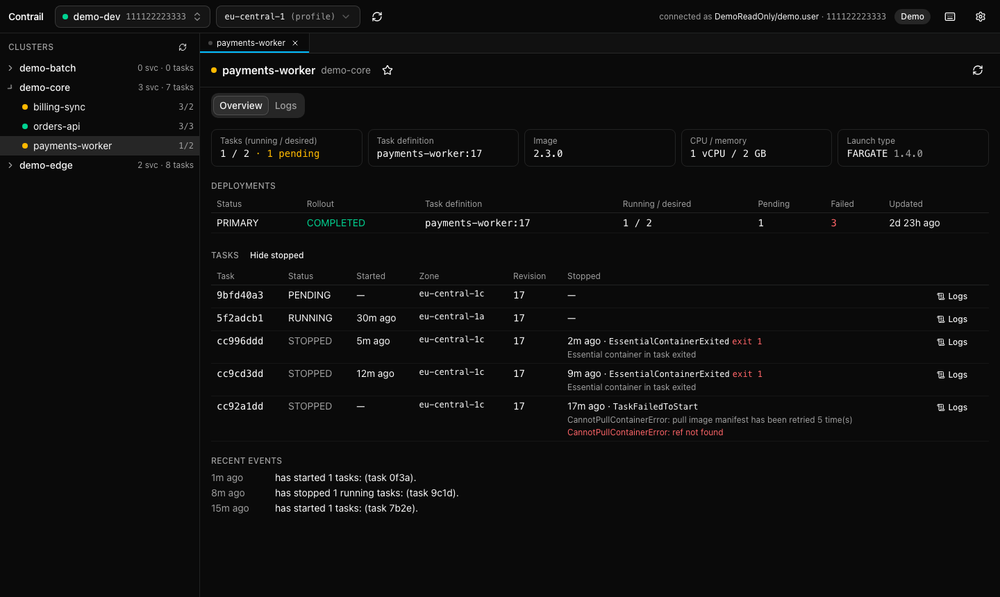
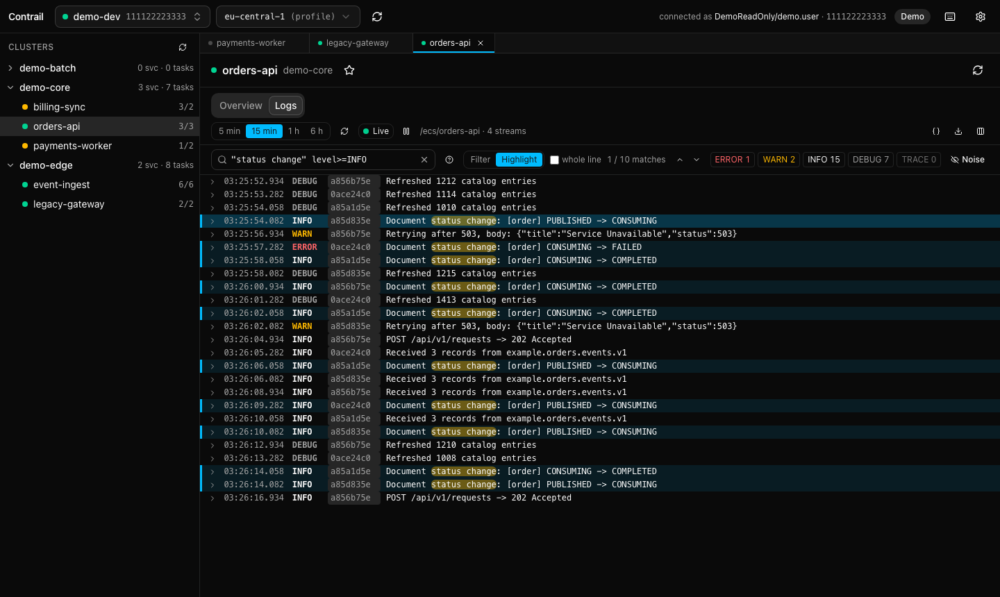

# Contrail

A fast, focused desktop log viewer for AWS ECS services.
Switch AWS SSO profiles, browse clusters → services → tasks, and jump straight into live,
readable logs — structured (ECS JSON) or plain — with session search.

> **Status:** v0.1 — profiles, SSO login, ECS browsing, the log viewer with live tail, search, tabs and
> export. See [CHANGELOG.md](CHANGELOG.md), and [plan.md](plan.md) for scope and milestones.

Contrail is strictly **read-only** towards AWS and never stores credentials.



| Service overview | Search (highlight mode) |
| --- | --- |
|  |  |

## Install

Download the installer for your system from the [latest release](https://github.com/Clon1998/contrail/releases/latest):

| System | File |
| --- | --- |
| macOS, Apple silicon | `Contrail_<version>_aarch64.dmg` |
| macOS, Intel | `Contrail_<version>_x64.dmg` |
| Windows | `Contrail_<version>_x64-setup.exe` (installs per user, no admin rights needed) |
| Linux | `.AppImage`, `.deb` or `.rpm` |

The builds are **not code-signed** yet:

- **macOS:** the first start is blocked ("cannot be opened" / "damaged"). Right-click the app → *Open*, or
  System Settings → Privacy & Security → *Open Anyway*. If macOS still refuses:
  `xattr -dr com.apple.quarantine /Applications/Contrail.app`.
- **Windows:** SmartScreen asks once: *More info* → *Run anyway*.
- **Linux:** make the AppImage executable (`chmod +x Contrail_*.AppImage`). The app uses WebKitGTK 4.1.

There is no auto-update in v0.1: install a newer release over the old one.

## First run

1. Install the [AWS CLI v2](https://docs.aws.amazon.com/cli/latest/userguide/getting-started-install.html) and
   configure your SSO profiles as usual (`aws configure sso`). Contrail reads `~/.aws/config`
   (`%USERPROFILE%\.aws\config` on Windows, or `AWS_CONFIG_FILE`).
2. Start Contrail and pick a profile (⌘⇧P / Ctrl+Shift+P). If its session expired, **Log in** runs
   `aws sso login` and opens the browser.
3. Pick a cluster and service in the sidebar (or ⌘K / Ctrl+K), then the **Logs** tab.

**Permissions:** Contrail needs only read access; [docs/iam-policy.json](docs/iam-policy.json) lists exactly
the actions it calls, for teammates whose role must be extended. A missing permission is reported as such
(with the action), not as a login problem.

### Demo mode

Try Contrail without AWS: invented profiles, clusters and logs, no network access at all.

- Installed app: start it with `--demo`, e.g. `open -a Contrail --args --demo` (macOS),
  `"%LOCALAPPDATA%\Contrail\contrail.exe" --demo` (Windows), or set `CONTRAIL_DEMO=1`.
- From source: `pnpm dev:demo` in `app/`.

Demo mode powers the UI tests and the screenshots above.

## Using it

- Contrail lists the profiles from `~/.aws/config` (or `AWS_CONFIG_FILE`) with their SSO session state.
- **Log in** runs `aws sso login --profile <name>` for you, so [AWS CLI v2](https://docs.aws.amazon.com/cli/latest/userguide/getting-started-install.html)
  must be installed. Contrail only reads the expiry of the SSO token cache; the AWS SDK handles credentials.
- Switch profiles with ⌘⇧P / Ctrl+Shift+P (search by name, account ID or region).
- Browse **Cluster → Service** in the sidebar; a service shows its tasks (running and recently stopped, with
  stop reasons and exit codes), deployments, task definition and recent events. It refreshes every 30 s.
- **⌘K / Ctrl+K** jumps to any service of the current profile, or to a recently opened one of any profile.
  Star a service to pin it to the sidebar. Favorites, recent services, the last profile and region overrides
  are kept in `prefs.json` in Contrail's app data folder (never credentials).
- The log viewer scrolls smoothly through up to 100,000 lines, starts at the newest, and expands a line into its
  fields, raw JSON, embedded JSON and stack trace (with copy buttons). A task's **Logs** button shows only that
  task; the columns button adds logger, thread or correlation/trace ID.
- After loading the past minutes, a log view **follows live** (CloudWatch Live Tail; new tasks of the service are
  included automatically). The toolbar shows the state and lets you pause. Without the `logs:StartLiveTail`
  permission Contrail checks for new events every 2 seconds instead. Live Tail is billed per session minute:
  by default tails pause while Contrail is hidden (after 30 s) and resume with a catch-up when you're back.
- A service's **Logs** tab loads the last minutes of all its tasks' logs (running and recently stopped) from
  CloudWatch: ECS JSON (nested or dotted), Spring Boot's console pattern and plain text are parsed, and Java
  stack traces that CloudWatch split into one event per line are joined again. The log group comes from the
  task definition (`awslogs` driver with a stream prefix).
- **Search** the loaded logs: `timeout level>=WARN trace.id:abc123 -healthcheck`, regular expressions, field
  globs and comparisons, as a filter or highlighted with next/previous (Enter, F3). Level chips hide levels;
  "Hide lines like this" builds a per-service noise list. See [docs/query-syntax.md](docs/query-syntax.md).
- **Tabs:** every opened service stays open in a tab with its search and live tail (⌘/Ctrl+1…9, Ctrl+Tab).
- **Export** the listed lines as `.log` or `.jsonl`; **field mapping** for JSON logs with other field names.
- **Keyboard shortcuts:** press `?`.
- **Settings** (gear icon or ⌘, / Ctrl+,): theme (dark / light / system), accent colour, UI size, log font size,
  default log time window, buffer size, live tail pausing and timestamps in local time or UTC.

## Known limitations

- **Unsigned builds** (see Install): macOS Gatekeeper and Windows SmartScreen warn on first start.
- **SSO login needs the AWS CLI v2**; other credential sources (static keys, `credential_process`, …) work
  through the AWS SDK but have no login button.
- **Logs must come from the `awslogs` driver with a stream prefix** (the ECS default). FireLens/other drivers
  are reported as "logs unavailable".
- **Live Tail** is billed per session minute and sends at most 500 events per second (Contrail shows
  "sampled" then). Tails pause while the window is hidden and in background tabs (configurable). Without
  `logs:StartLiveTail`, Contrail polls every 2 seconds.
- A view keeps up to the buffer size (default 100,000 events); older events are dropped, and very large time
  windows are cut off ("truncated").
- Search runs over the loaded events only, not over CloudWatch (no Logs Insights queries).

## Development

Prerequisites:

- [Rust](https://rustup.rs) via rustup (the exact version is pinned in `rust-toolchain.toml` and installed automatically)
- Node.js ≥ 24 and [pnpm](https://pnpm.io) 12
- Tauri's [system prerequisites](https://v2.tauri.app/start/prerequisites/) for your OS

```bash
cd app
pnpm install          # also installs the git hooks (lefthook)
pnpm dev              # run the app with hot reload (tauri dev)
pnpm build            # build installers for this OS (tauri build)
```

Checks (the same ones CI runs):

```bash
cargo fmt --all -- --check
cargo clippy --workspace --all-targets -- -D warnings
cargo test --workspace
cd app && pnpm lint && pnpm typecheck && pnpm test
pnpm test:e2e         # Playwright UI flows (in app/; uses a fake backend, no Tauri)
```

### Layout

| Path                    | What                                                               |
| ----------------------- | ------------------------------------------------------------------ |
| `crates/contrail-core/` | Domain model, source traits, parsing, buffer, query — no AWS deps  |
| `crates/contrail-aws/`  | AWS implementations of the core traits                             |
| `crates/contrail-fake/` | Fake implementations and log generators (demo mode, tests)         |
| `app/`                  | The desktop app: Tauri CLI and repo tooling (pnpm workspace root)  |
| `app/src-tauri/`        | Tauri app crate: commands, state, wiring                           |
| `app/ui/`               | React + Vite frontend (shadcn/ui, Tailwind); tests beside the code |
| `docs/`                 | [Rust notes](docs/rust-notes.md), [decisions](docs/decisions.md)   |

Every CI run on `main` also builds a Windows and a macOS installer as run artifacts
(`gh run download <run id> -n contrail-windows`). Releases are built by pushing a `v*` tag
(`.github/workflows/release.yml`); `CHANGELOG.md` is generated with git-cliff (see `cliff.toml`).
README screenshots: `SCREENSHOTS=1 pnpm exec playwright test screenshots --project=chromium` in `app/ui/`.

Commits follow [Conventional Commits](https://www.conventionalcommits.org) (enforced by a commit-msg hook).

## License

[MIT](LICENSE)
